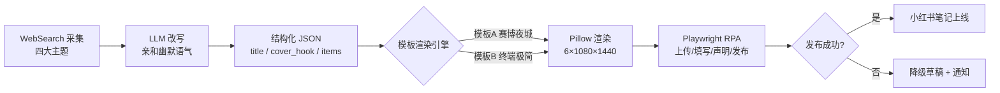

# AI Daily · 小红书图文自动生成与发布流水线

> 一个端到端自动化的 AI 内容产品：每天定时采集 AI 行业资讯 → 大模型改写 → 程序化渲染图文 → 浏览器自动化发布到小红书。
> **对 AI 产品经理岗位而言，这个项目覆盖了从 Prompt 工程、多模态生成、数据 schema 设计到 RPA 发布、数据驱动迭代的完整链路。**

[](https://www.python.org/) [](https://python-pillow.org/) [](https://playwright.dev/) [](./LICENSE)

---

## 在线演示（真实运行的内容账号）

本项目驱动的真实账号（小红书 · 零阶产品谱）：

- **账号主页**：<https://www.xiaohongshu.com/user/profile/6111d74d0000000001008628>
- **已发布笔记**（2026-10-25 从创作平台实时抓取生成）：
  - [AI 日报：研究员年薪 120 万](https://www.xiaohongshu.com/explore/6addd8f5000000002b000fdc?xsec_token=YBfHulREua_HyW8faKdTS030OAMccIJujQaGJ-0r24h0s=&xsec_source=pc_creatormng) —— 模板B（终端极简）成品，6 张图 + 文案全自动产出
  - [AI圈炸了🔥融资扎堆PM降42%](https://www.xiaohongshu.com/explore/6addb0f8000000002b02a202?xsec_token=YBfHulREua_HyW8faKdTS03_d0CKsxM8MJNrA6YNCkIWo=&xsec_source=pc_creatormng)

> xsec_token 是小红书的防盗链签名，会定期过期；过期后访问上方主页链接仍可查看全部笔记。

---

## 一、它解决什么问题

AI 资讯类内容账号的日常运营是高度重复的劳动：找资讯 → 写文案 → 做图 → 发布。本项目把这条链路完整自动化：

| 环节 | 人工成本（原） | 本项目 |
| --- | --- | --- |
| 资讯采集 | 30–60 分钟浏览多源 | 自动检索，四主题结构化 |
| 文案生产 | 30 分钟撰写改写 | Prompt 工程驱动，幽默语气重写 |
| 图文制作 | 60+ 分钟设计排版 | 模板化渲染管线，6 张 1080×1440 |
| 平台发布 | 10 分钟手动操作 | Playwright RPA 一键发布 |

**结果**：每天 08:00 全自动产出一篇完整图文笔记，人工零介入（发布失败自动降级为草稿并通知）。

## 二、系统架构



**设计要点**：数据层（JSON schema）与视觉层（模板引擎）完全解耦——同一份数据可切换任意视觉模板渲染，这是「多模态内容生成」产品化的关键抽象。

## 三、核心模块

```
pipeline/
├── render_template_a.py      # 模板A渲染器：深色霓虹 / 实色渐变块 / 轻磨砂
├── render_template_b.py      # 模板B渲染器：GitHub Dark / 语法高亮 / 等宽字体
└── publish_flow.js           # Playwright 发布脚本（RPA）
samples/
└── 2026-10-25.json           # 一日完整数据样例（含 title / cover_hook）
docs/
├── ARCHITECTURE.md           # 架构与数据流详解
├── AUTOMATION_PROMPT.md      # 每日任务的完整 Prompt 工程（7 步）
├── ITERATION_LOG.md          # 视觉产品迭代记录 v1→v10
├── TEMPLATE_B.md             # 模板B设计规范
└── LESSONS.md                # 22 条踩坑手册（工程严谨性证明）
```

### 1. 数据 schema 设计（产品思维体现）

```json
{
  "title": "AI 日报：研究员年薪 120 万",
  "topics": {
    "ai_salary": {
      "cover_hook": "研究员 P50 年薪 120 万\n同比 +35%",
      "summary": "小编说：钱景是真香……",
      "items": [{ "headline": "", "detail": "", "source": "" }]
    }
  }
}
```

- `cover_hook`（封面钩子）字段是**内容策略的产品化**：参考小红书同类爆款封面的信息密度规律，强制要求「当天最炸的一个数字 + `\n` 精确断两行 + 每行 ≤13 字」，把爆款玄学变成可执行的字段约束
- `title` ≤20 字硬约束（平台限制 + 数字钩子），失败有 fallback 链，保证流水线不中断

### 2. 模板化渲染引擎（多模态生成）

- 纯 Pillow 程序化绘图：渐变背景、柔光、颗粒、暗角、磨砂面板、边缘高光、迷你数据图（柱状/折线/阶梯/¥）
- **双模板体系**：模板A（深紫霓虹赛博夜城）与模板B（终端极简程序员风）共用同一数据层，验证了「数据-视觉解耦」架构
- 所有坐标 `int(round())` 防浮点崩溃；半透明元素一律独立 RGBA 图层合成——坑位与规避全部记录在 [LESSONS.md](./docs/LESSONS.md)

### 3. Prompt 工程（AI PM 核心技能）

完整 7 步任务 Prompt 见 [AUTOMATION_PROMPT.md](./docs/AUTOMATION_PROMPT.md)，包含：
- 采集约束（四主题覆盖、条数、来源可溯）
- 改写约束（语气幽默但**数字事实零改动**）
- schema 约束（字段规则 + `\n` 断行 + 禁用词）
- 异常降级路径（发布失败 → 草稿 → 通知，禁止无限重试）

### 4. RPA 发布（Playwright）

处理了真实生产环境的全部脏活，详见 [LESSONS.md](./docs/LESSONS.md)：
- 平台改版后的元素定位策略（封闭 shadow DOM 组件 → 像素级坐标定位）
- 必填项自动化（「笔记含AI合成内容」声明）
- 成功判据只用 URL 特征（`published=true`），不依赖 DOM 文本

## 四、数据驱动的产品迭代（重点）

这不是一次写成的代码，而是**用户反馈驱动的十轮视觉迭代**，完整记录在 [ITERATION_LOG.md](./docs/ITERATION_LOG.md)：

| 版本 | 用户反馈 | 产品决策 |
| --- | --- | --- |
| v1–v3 | 「像商务 PPT」「很丑」 | 从主页截图量化取色，建立色彩基准 |
| v4 | 「不要粉色」 | 弃用品红，色相环重新分布 |
| v6 | 「磨砂一丢丢就够了」 | 量化「一丢丢」：投影 alpha105→46 |
| v9 | 「上段最满意，中段颜色暗」 | 三段拆解，实色渐变替换半透明叠色 |
| v10 | 「参考爆款封面」 | 中段从「目录」改「预告清单」+ 数字钩子 |

每轮反馈都转化为**可验证的视觉参数变更**并沉淀为模板规范——这是「用户反馈 → 数据指标 → 产品迭代」闭环的完整样本。

## 五、快速开始

```bash
# 环境：Python 3.13 + Pillow
pip install pillow

# 渲染（模板B，输出 6 张 1080×1440）
python pipeline/render_template_b.py samples/2026-10-25.json --outdir out_b

# 渲染（模板A）
python pipeline/render_template_a.py samples/2026-10-25.json --outdir out_a
```

发布脚本需自行配置：编辑 `pipeline/publish_flow.js` 顶部的工作区路径，并在 Playwright 中登录小红书创作平台（需已登录的浏览器 profile）。

## 六、目录结构

```
.
├── pipeline/                # 渲染 + 发布引擎
├── samples/                 # 数据样例（schema 参考）
├── docs/                    # 架构 / Prompt / 迭代记录 / 规范 / 踩坑手册
├── README.md
├── LICENSE
└── .gitignore
```

## 七、已知限制与 Roadmap

- [ ] 发布成功率监控与自动重试策略（当前为单次 + 人工兜底）
- [ ] 渲染结果自动质检（文字溢出检测、对比度检查）
- [ ] 多平台适配（公众号 / 即刻）
- [ ] A/B 测试框架：双模板流量对比，用数据决定默认模板

## License

MIT
